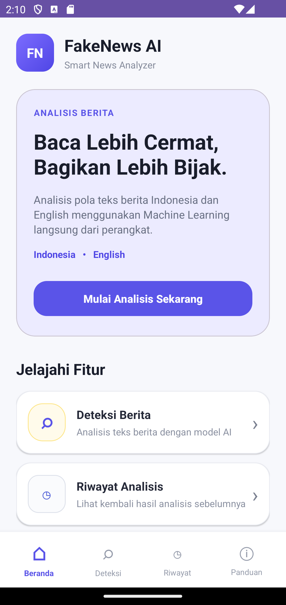
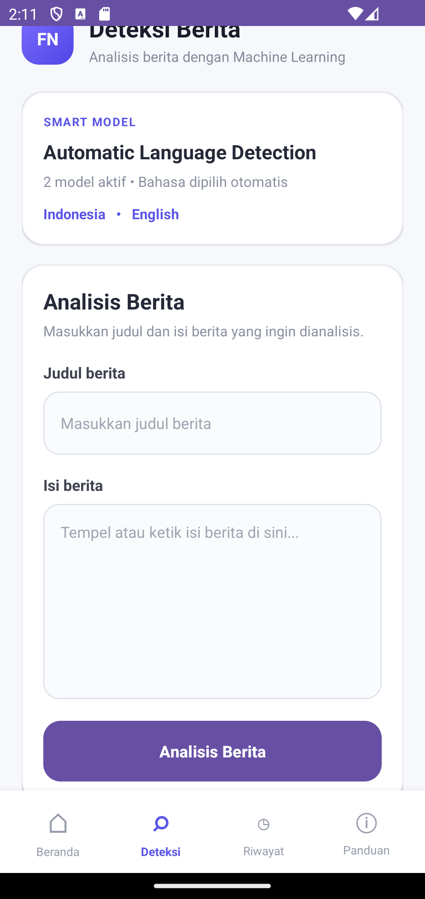
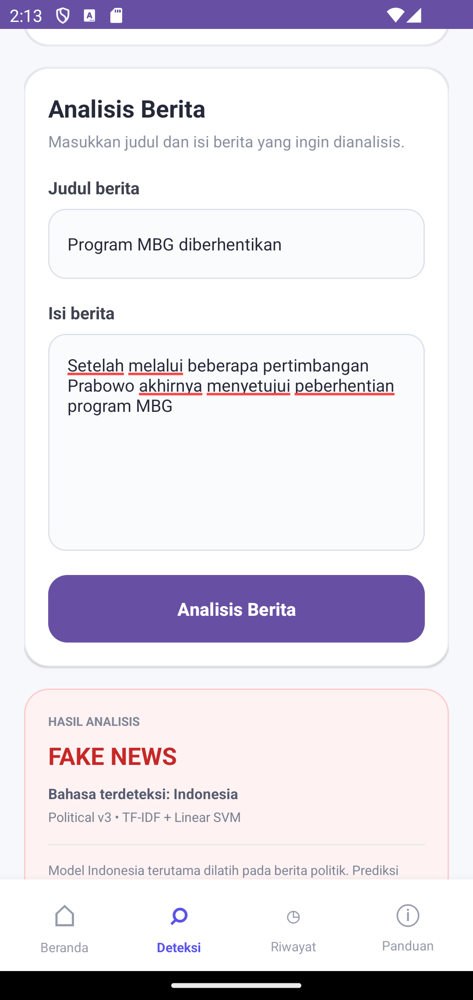
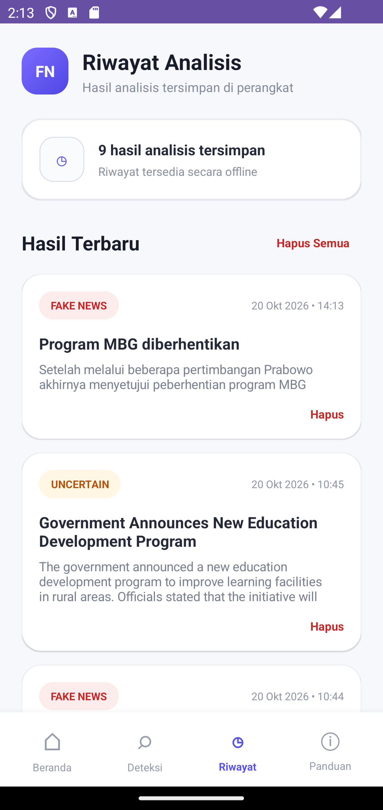

\# Fake News Detection


Project Machine Learning untuk melakukan klasifikasi artikel berita menjadi \*\*FAKE\*\* atau \*\*REAL\*\* menggunakan teknik Text Classification.


\## Dataset


Dataset yang digunakan adalah \*\*Fake and Real News Dataset (ISOT)\*\*.


Jumlah data awal:

\- FAKE: 23.481 artikel

\- REAL: 21.417 artikel

\- Total: 44.898 artikel


Setelah proses cleaning, jumlah data yang digunakan adalah 44.680 artikel.


\## Tahapan Machine Learning


1\. Pengumpulan Dataset

2\. Pelabelan Data

3\. Data Cleaning

4\. Text Preprocessing

5\. Analisis Distribusi Data

6\. Train-Test Split

7\. TF-IDF

8\. Training Model

9\. Evaluasi Model

10\. Prediksi Berita Baru


\## Pembagian Dataset


\- Training: 80%

\- Testing: 20%


Jumlah:

\- Training: 35.744 data

\- Testing: 8.936 data


\## Text Representation


Metode yang digunakan:


\*\*TF-IDF (Term Frequency - Inverse Document Frequency)\*\*


Jumlah fitur:


50.000 fitur.


\## Model yang Dibandingkan


\### Multinomial Naive Bayes


\- Accuracy: 93.49%

\- Precision: 93.55%

\- Recall: 92.67%

\- F1-Score: 93.11%


\### Logistic Regression


\- Accuracy: 97.94%

\- Precision: 97.61%

\- Recall: 98.07%

\- F1-Score: 97.84%


\### Linear SVM


\- Accuracy: 98.95%

\- Precision: 98.85%

\- Recall: 98.94%

\- F1-Score: 98.89%


\## Final Model


Berdasarkan hasil evaluasi pada data testing, Linear SVM memperoleh performa tertinggi pada eksperimen ini.


\## Technology


\- Python

\- Google Colab

\- Pandas

\- NumPy

\- Scikit-learn

\- Matplotlib

\- TF-IDF

\- Git

\- GitHub


\## Notebook


Notebook utama:


`fake\_news\_detection.ipynb`


\## Label


\- `0` = FAKE

\- `1` = REAL

## Android Debug Build

### Requirements
- JDK 21 atau JDK yang kompatibel dengan konfigurasi Gradle
- Android SDK (termasuk platform SDK 36.1)
- Gradle Wrapper 9.3.1 (sudah tersedia dalam repository)

### Build Instructions

1. Clone repository.
2. Masuk ke folder `android-app`.
3. Konfigurasi Android SDK melalui `ANDROID_HOME` atau
   `local.properties` (file ini tidak disimpan di Git).
4. Jalankan:

   Windows:
   `.\gradlew.bat --no-daemon clean assembleDebug`

5. APK debug tersedia di:
   `android-app/app/build/outputs/apk/debug/app-debug.apk`

### Verification

Fresh clone build berhasil pada Windows 11.
Build: SUCCESSFUL (33 detik).
APK: berhasil dibuat.
Git working tree: clean.
---

## Android Offline Machine Learning Inference

Aplikasi Android Fake News Detection menggunakan model Machine Learning
asli berbasis TF-IDF dan Linear Support Vector Machine (Linear SVM).

Inferensi model dijalankan secara offline menggunakan ONNX Runtime
Android, tanpa memerlukan koneksi internet atau API eksternal.

### Model yang Digunakan

Aplikasi mendukung dua model:

1. English v1.3
   - Model: fake_news_model_en_v13.onnx
   - TF-IDF Word: 100.000 fitur
   - TF-IDF Character: 50.000 fitur
   - Algoritma: Linear SVM
   - Mendukung hasil UNCERTAIN

2. Indonesian Political v3
   - Model: fake_news_model_id_political_v3.onnx
   - TF-IDF Word: 100.000 fitur
   - Algoritma: Linear SVM
   - Terutama ditujukan untuk berita politik Indonesia

Kedua model ONNX disimpan di:

`android-app/app/src/main/assets/`

### Arsitektur Inferensi

Alur prediksi aplikasi:

1. Pengguna memasukkan judul dan isi berita.
2. Aplikasi mendeteksi bahasa secara otomatis.
3. Teks diproses menggunakan preprocessing yang sesuai.
4. Aplikasi membentuk vektor TF-IDF menggunakan vocabulary dan IDF dari JSON.
5. ONNX Runtime menjalankan inferensi model Linear SVM.
6. Skor prediksi diubah menjadi label FAKE, REAL, atau UNCERTAIN sesuai aturan model.
7. Hasil ditampilkan dan disimpan dalam riwayat lokal.

### Implementasi Android

Bahasa pemrograman: Kotlin

Komponen utama:

- `FakeNewsClassifier.kt`: preprocessing, TF-IDF, deteksi bahasa, dan klasifikasi.
- `OnnxSvmScorer.kt`: pemanggilan model melalui ONNX Runtime.
- `MainActivity.kt`: input pengguna, prediksi, dan pengelolaan lifecycle model.

Pemuatan model dan inferensi dilakukan melalui background worker
agar tidak memblokir UI Android.

### Label Prediksi

Label yang digunakan aplikasi:

- `0` = FAKE NEWS
- `1` = REAL NEWS
- `-1` = UNCERTAIN

Model Indonesian Political v3 memiliki pemetaan label internal
yang berbeda, sehingga output dikonversi menjadi label aplikasi.

### Pengujian Integrasi

Pengujian pada Android Emulator:

- Android debug build berhasil.
- Model Indonesia berhasil melakukan prediksi.
- Model Inggris berhasil melakukan prediksi.
- Hasil pada dua contoh pengujian sesuai dengan implementasi JSON sebelumnya.
- Navigasi aplikasi berjalan tanpa crash pada pengujian akhir.

Catatan: hasil evaluasi pada bagian awal README berasal dari
eksperimen Machine Learning sebelumnya dan tidak otomatis
merepresentasikan akurasi kedua model ONNX yang digunakan aplikasi.

Prediksi model adalah klasifikasi berdasarkan pola teks,
bukan verifikasi fakta secara real-time.
---

## Fitur Aplikasi Android

FakeNews AI adalah aplikasi Android berbasis Kotlin untuk
klasifikasi teks berita menggunakan Machine Learning offline.

Fitur utama:

- Deteksi otomatis bahasa Indonesia dan Inggris.
- Prediksi menggunakan TF-IDF, Linear SVM, dan ONNX Runtime.
- Menampilkan hasil FAKE NEWS, REAL NEWS, atau UNCERTAIN.
- Menyimpan hasil analisis dalam riwayat lokal.
- Menampilkan kembali riwayat tanpa koneksi internet.
- Validasi input dan penanganan kesalahan.

## Screenshot Aplikasi

### Beranda


### Form Deteksi


### Hasil Analisis


### Riwayat


## Cara Menjalankan Aplikasi

1. Clone repository dari GitHub.
2. Buka folder android-app menggunakan Android Studio.
3. Pastikan Android SDK dan JDK sudah terkonfigurasi.
4. Lakukan Gradle Sync.
5. Jalankan aplikasi menggunakan emulator atau perangkat Android.
6. Masukkan judul dan isi berita pada halaman Deteksi.
7. Tekan Analisis Berita untuk menjalankan model ONNX.
8. Buka halaman Riwayat untuk melihat hasil yang tersimpan.

Perintah build dari folder android-app:

    .\gradlew.bat --no-daemon clean assembleDebug

Lokasi APK:

    android-app/app/build/outputs/apk/debug/app-debug.apk

## Skenario Demonstrasi

Panduan demonstrasi tersedia di:

[Demo Scenario](docs/demo-scenario.md)

## Reproduksi Artefak Model (Issue #13)

Aplikasi Android menggunakan dua pasang artefak ONNX + JSON:

| Artefak | Ukuran | Keterangan |
|---|---|---|
| `fake_news_model_en_v13.onnx` | ~587 KB | LinearSVC EN, dual TF-IDF |
| `fake_news_model_en_v13.json` | ~8,2 MB | vocab + idf + coef + metrics |
| `fake_news_model_id_political_v3.onnx` | ~391 KB | LinearSVC ID, single TF-IDF |
| `fake_news_model_id_political_v3.json` | ~4,4 MB | vocab + idf + coef |

### Prasyarat

```bash
pip install -r requirements-src.txt   # Python 3.10+, semua versi dipin
```

### Langkah Regenerasi (dari clone bersih)

```bash
# 1. Siapkan dataset
#    EN  : Fake.csv + True.csv dari ISOT → taruh di data/
#    ID  : id_political.csv              → taruh di data/
#    Lihat data/README.md untuk sumber dataset.

# 2. Latih model (.pkl)
python src/train.py --data-dir data/ --out-dir models/

# 3. Ekspor ke ONNX + JSON
python src/export_android.py --model-dir models/ \
    --out-dir android-app/app/src/main/assets/

# 4. Evaluasi artefak ONNX + uji paritas
python src/evaluate.py --data-dir data/ \
    --assets-dir android-app/app/src/main/assets/
# Output: android-app/app/src/main/assets/metrics.json
```

### Struktur src/

```
src/
├── train.py           # Latih LinearSVC EN + ID dari dataset mentah → .pkl
├── export_android.py  # Konversi .pkl → ONNX + JSON (format aplikasi Android)
└── evaluate.py        # Evaluasi ONNX, confusion matrix, uji paritas 20 sampel
data/
├── .gitkeep
├── README.md          # Petunjuk download dataset
├── Fake.csv           # (tidak di-commit — terlalu besar)
├── True.csv           # (tidak di-commit)
└── id_political.csv   # (tidak di-commit)
models/                # Output train.py — tidak di-commit
requirements-src.txt   # Dependensi terpin untuk src/
```

### Catatan Evaluasi Machine Learning

Metrik di bagian awal README (93,49% / 97,94% / 98,95%) adalah hasil
eksperimen awal pada notebook dengan TF-IDF 50k fitur dan model `.pkl`.

Artefak yang sebenarnya dipakai aplikasi (EN v1.3 dan ID Political v3)
menggunakan konfigurasi berbeda (100k word + 50k char untuk EN).
Metrik resmi artefak ONNX tersimpan di `metrics.json` yang dihasilkan
`src/evaluate.py` setelah regenerasi.

Aplikasi melakukan klasifikasi berdasarkan pola teks,
bukan verifikasi kebenaran berita secara real-time.
